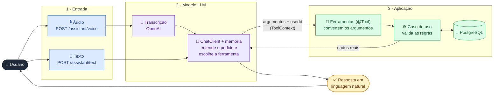
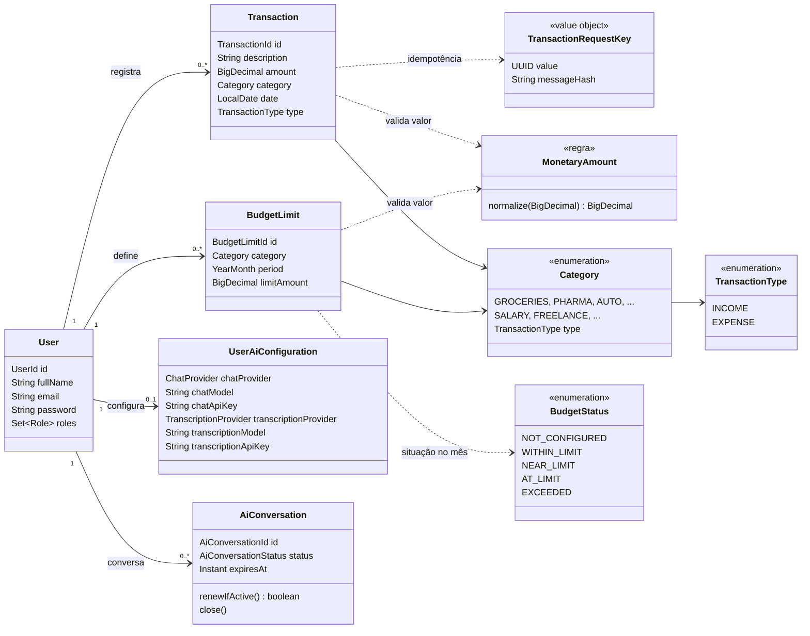
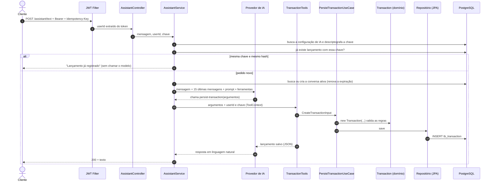

<h1 align="center">Budgeting</h1>

<p align="center">
  API de finanças pessoais com um assistente de IA que entende <b>voz e texto</b> e executa funções reais da aplicação.
</p>

<p align="center">
  
  
  
  
  
</p>

<p align="center">
  
  
</p>

---

## Índice

- [Sobre o projeto](#sobre-o-projeto)
- [Funcionalidades](#funcionalidades)
- [Como o assistente funciona](#como-o-assistente-funciona)
- [O que evoluiu em relação ao projeto base](#o-que-evoluiu-em-relação-ao-projeto-base)
- [Tecnologias](#tecnologias)
- [Como executar](#como-executar)
- [Como testar o fluxo principal](#como-testar-o-fluxo-principal)
- [Endpoints](#endpoints)
- [Testes automatizados](#testes-automatizados)
- [Arquitetura](#arquitetura)
- [Limitações conhecidas](#limitações-conhecidas)
- [Uso de IA no desenvolvimento](#uso-de-ia-no-desenvolvimento)
- [O que aprendi](#o-que-aprendi)
- [Autor](#autor)

---

## Sobre o projeto

O Budgeting substitui a planilha e as anotações soltas: você registra receitas e despesas, acompanha quanto gastou em cada categoria no mês e define limites de orçamento. Tudo isso pela API REST, documentada no Swagger, **ou conversando com um assistente**: *"gastei 40 reais no mercado hoje"*, por texto ou áudio, vira um lançamento salvo no banco.

O ponto central não é "usar IA", e sim **conectar a IA a uma aplicação real sem quebrar suas regras**. O modelo de linguagem interpreta o pedido e escolhe uma ferramenta, mas quem valida e grava é o mesmo caso de uso que atende o REST, com as mesmas regras e o mesmo isolamento entre usuários.

Projeto desenvolvido no Desafio de Projeto de Spring AI da [DIO](https://www.dio.me/), evoluído a partir do módulo [`05-spring-ai`](https://github.com/digitalinnovationone/dio-spring-boot-learning-track/tree/main/05-spring-ai) da trilha Spring Boot.

## Funcionalidades

**Finanças (REST, sem precisar de IA)**

- `Conta e login`: cadastro, autenticação com JWT e troca de senha. Cada pessoa vê e altera somente os próprios dados.
- `Lançamentos`: registrar, corrigir, excluir e listar receitas e despesas. A listagem é por categoria, com datas opcionais e paginação.
- `Relatórios mensais`: total gasto em uma categoria no mês e resumo com receitas, despesas e saldo líquido.
- `Limites de orçamento`: um limite por categoria e mês, com valor gasto, restante, percentual e situação: `WITHIN_LIMIT`, `NEAR_LIMIT` (a partir de 80%), `AT_LIMIT` ou `EXCEEDED`. Atingir o limite nunca bloqueia um lançamento.

**Assistente de IA (opcional)**

- `Voz`: envia um áudio, que é transcrito e interpretado.
- `Texto`: mensagens digitadas na mesma conversa da voz.
- `Seis ferramentas`: registrar lançamento, listar por categoria, total do mês por categoria, resumo mensal, criar limite e consultar a situação do limite.
- `Conversa com memória`: o assistente lembra do contexto, pergunta o que falta (data, categoria, descrição) antes de gravar e encerra a conversa após 24 horas sem uso. Conversas encerradas são apagadas, sem guardar histórico.
- `IA de cada usuário`: cada pessoa configura o próprio provedor, modelo e chave. Chat: OpenAI, Anthropic, Gemini ou DeepSeek. Transcrição: OpenAI.

**Categorias disponíveis**

| Tipo | Categorias |
| --- | --- |
| Despesa | `GROCERIES`, `PHARMA`, `AUTO`, `HEALTH`, `TRANSPORT`, `HOUSING`, `ENTERTAINMENT`, `PERSONAL_CARE`, `EDUCATION`, `OTHER_EXPENSES` |
| Receita | `SALARY`, `FREELANCE`, `INVESTMENT`, `OTHER_INCOMES` |

O tipo (receita ou despesa) é definido pela categoria e não muda depois do cadastro.

## Como o assistente funciona



O áudio passa pela transcrição; o texto vai direto ao `ChatClient`. Os dois canais compartilham a mesma conversa e as mesmas ferramentas.

| Ferramenta | O que faz |
| --- | --- |
| `persist-transaction` | Registra uma receita ou despesa |
| `list-transaction-by-category-and-period` | Lista lançamentos de uma categoria, com datas opcionais |
| `list-monthly-expenses-by-category` | Total gasto em uma categoria no mês |
| `get-monthly-summary` | Receitas, despesas e saldo líquido do mês |
| `persist-budget-limit` | Cria o limite mensal de uma categoria de despesa |
| `get-budget-limit-status` | Limite, gasto, restante e situação |

Três decisões de projeto importantes:

- **O usuário não é um parâmetro da ferramenta.** A identidade vem do JWT e chega às ferramentas pelo `ToolContext`. O modelo não tem como operar em nome de outra pessoa, mesmo que a mensagem peça.
- **As ferramentas são adaptadores, não casos de uso.** As descrições lidas pelo modelo, a leitura do `ToolContext` e a conversão dos argumentos ficam em `TransactionTools` e `BudgetLimitTools`, na infraestrutura. Os casos de uso não dependem do Spring AI e são os mesmos chamados pelo REST.
- **Correções e exclusões ficam só no REST.** O assistente registra e consulta. Ações destrutivas exigem uma chamada explícita.

## O que evoluiu em relação ao projeto base

O projeto da aula implementa o fluxo áudio → transcrição → tool calling → resposta em áudio, com OpenAI configurada no servidor. A partir dele:

1. **Domínio financeiro completo:** edição e exclusão de lançamentos, relatórios mensais, limites de orçamento com situação e paginação.
2. **Seis ferramentas** em adaptadores próprios que chamam os casos de uso do REST, com um prompt de sistema (`src/main/resources/prompts/assistant_prompt.st`) que orienta quando perguntar antes de agir.
3. **Canal de texto** além da voz, na mesma conversa.

   **Resposta em texto, por decisão de projeto.** O projeto base convertia a resposta final em áudio. Optei por responder em texto: é mais prático de ler, consultar e copiar, especialmente quando a resposta traz valores e listas de lançamentos.

4. **Memória persistida no PostgreSQL**, com as 15 mensagens mais recentes como contexto, expiração por inatividade e uma única conversa ativa por usuário, garantida por bloqueio pessimista e índice único parcial. Ao encerrar ou expirar, a conversa e suas mensagens são apagadas.
5. **Configuração de IA por usuário**, com quatro provedores de chat. As chaves são **criptografadas** antes de ir para o banco e nunca aparecem nas respostas.
6. **Validações antes de salvar:** valor positivo e exato em centavos (fração de centavo é rejeitada, sem arredondar), até 17 dígitos inteiros, categoria compatível com o tipo, descrição obrigatória.
7. **Idempotência nos dois canais:** o header `Idempotency-Key` impede lançamentos duplicados quando o cliente reenvia a mesma mensagem ou a mesma gravação.
8. **Falhas de IA tratadas:** timeout de 30 s, sem retentativa automática (para não gravar duas vezes) e erros traduzidos em códigos `AI_PROVIDER_*`, como chave inválida, cota, limite de requisições e indisponibilidade. Se o lançamento já tinha sido salvo antes da falha, a resposta informa o ID em `X-Transaction-Id`.
9. **Segurança:** Spring Security com JWT, troca de senha com confirmação da senha atual e isolamento por usuário testado nos endpoints e nas ferramentas.
10. **Datas no padrão brasileiro** em toda a API: `dd/MM/yyyy` e `MM/yyyy`.
11. **Docker Compose** com script de inicialização para Windows, Linux e macOS, que gera os segredos sozinho.
12. **675 testes automatizados**, com PostgreSQL real via Testcontainers.

## Tecnologias

| Área | Tecnologias |
| --- | --- |
| Linguagem e framework | Java 25, Spring Boot 4.1, Spring Web MVC, Bean Validation |
| IA | Spring AI 2.0 (`ChatClient`, `@Tool`, `ToolContext`, memória de chat, `TranscriptionModel`); OpenAI, Anthropic, Google GenAI e DeepSeek |
| Persistência | Spring Data JPA, PostgreSQL 18, Flyway |
| Segurança | Spring Security, JJWT, BCrypt, criptografia AES-GCM das chaves de API |
| Documentação | springdoc-openapi (Swagger UI) |
| Testes | JUnit 5, Mockito, Spring Boot Test, Testcontainers, JaCoCo |
| Infraestrutura | Docker, Docker Compose |
| Build | Maven Wrapper |

## Como executar

### Pré-requisitos

- **Docker Desktop**, ou Docker Engine com Compose.
- **JDK 25**, só para rodar os testes ou a API fora do Docker.
- Para usar o assistente: uma chave de API de um provedor de chat e, para voz, uma chave da OpenAI para a transcrição.

### Opção 1: script de inicialização

| Sistema | Como iniciar |
| --- | --- |
| Windows | Dê dois cliques em **`Iniciar-Budgeting-Windows.cmd`** (requer o Git for Windows) |
| macOS | Dê dois cliques em **`Iniciar-Budgeting-macOS.command`**. Se o macOS bloquear, clique com o botão direito e escolha **Abrir** |
| Linux | No terminal, na pasta do projeto: `./scripts/iniciar.sh` |

Os três caminhos executam o mesmo script, que pergunta:

| Pergunta | Sugestão |
| --- | --- |
| Usuário do PostgreSQL | Enter (`budgeting`) |
| Senha do PostgreSQL | Enter (gera uma senha aleatória) |
| Porta local da API | Enter (`8080`) |

Em seguida ele gera os segredos (JWT e criptografia), cria o `.env` e sobe tudo com Docker Compose. A primeira execução leva alguns minutos, porque baixa as imagens e compila a aplicação.

### Opção 2: Docker Compose em qualquer sistema

```bash
cp .env.example .env
```

Preencha o `.env`. Para gerar valores aleatórios, use `openssl rand -hex 32`:

```properties
DB_USER_KEY=budgeting
DB_PASSWORD_KEY=<senha do banco>
SERVER_PORT_KEY=8080
JWT_KEY=<valor aleatório com pelo menos 32 caracteres>
JWT_EXPIRATION=86400000
AI_ENCRYPTION_PASSWORD=<valor aleatório>
AI_ENCRYPTION_SALT=<valor hexadecimal aleatório>
```

```bash
docker compose up --build -d
docker compose logs -f api      # aguarde "Started BudgetingApplication"
```

O Swagger fica em **http://localhost:8080/swagger-ui/index.html**. O Flyway cria o esquema sozinho em um banco vazio. Para parar, use `docker compose down`, que mantém os dados. Para apagar tudo, use `docker compose down -v`.

### Opção 3: API fora do Docker

Com um PostgreSQL acessível (por padrão `jdbc:postgresql://localhost:5432/budgeting`; para outro banco, ajuste `DB_URL_KEY` no `.env`):

```bash
./mvnw spring-boot:run
```

## Como testar o fluxo principal

Os passos funcionam no **Swagger** (use o botão **Authorize** e cole o token sem o prefixo `Bearer`) ou com `curl`.

### 1. Criar a conta e fazer login

```bash
curl -X POST http://localhost:8080/api/v1/users \
  -H "Content-Type: application/json" \
  -d '{"fullName":"Maria Silva","email":"maria@email.com","password":"segredo123"}'

curl -X POST http://localhost:8080/api/v1/auth/login \
  -H "Content-Type: application/json" \
  -d '{"email":"maria@email.com","password":"segredo123"}'
# {"token":"eyJ..."}
```

Nos comandos seguintes, use `-H "Authorization: Bearer $TOKEN"`.

### 2. Fluxo financeiro pelo REST

```bash
# Limite de R$ 500 para mercado em novembro/2026
curl -X POST http://localhost:8080/api/v1/budgets \
  -H "Authorization: Bearer $TOKEN" -H "Content-Type: application/json" \
  -d '{"category":"GROCERIES","period":"11/2026","limitAmount":500.00}'

# Despesa de R$ 40 no mesmo mês
curl -X POST http://localhost:8080/api/v1/transactions \
  -H "Authorization: Bearer $TOKEN" -H "Content-Type: application/json" \
  -d '{"description":"Feira","amount":40.00,"category":"GROCERIES","date":"10/11/2026"}'

# Conferências
curl "http://localhost:8080/api/v1/transactions?category=GROCERIES" -H "Authorization: Bearer $TOKEN"
curl "http://localhost:8080/api/v1/transactions/monthly/expenses?yearMonth=11/2026&category=GROCERIES" -H "Authorization: Bearer $TOKEN"
curl "http://localhost:8080/api/v1/budgets?period=11/2026&category=GROCERIES" -H "Authorization: Bearer $TOKEN"
curl "http://localhost:8080/api/v1/transactions/monthly/summary?yearMonth=11/2026" -H "Authorization: Bearer $TOKEN"
```

Em uma conta nova, o resultado esperado é:

| Consulta | Resultado |
| --- | --- |
| Listagem | 1 lançamento, R$ 40,00, data `10/11/2026` |
| Total da categoria | `40.00` |
| Situação do limite | gasto `40.00`, restante `460.00`, `8.00`%, `WITHIN_LIMIT` |
| Resumo do mês | receitas `0`, despesas `40.00`, saldo `-40.00` |

### 3. Configurar a IA

```bash
curl -X POST http://localhost:8080/api/v1/users/ai-config \
  -H "Authorization: Bearer $TOKEN" -H "Content-Type: application/json" \
  -d '{
        "chatProvider": "OPENAI",
        "chatModel": "gpt-4.1-mini",
        "chatApiKey": "<sua chave>",
        "transcriptionProvider": "OPENAI",
        "transcriptionModel": "whisper-1",
        "transcriptionApiKey": "<sua chave>"
      }'
```

Chat e transcrição podem ser configurados separadamente: só o chat já libera o canal de texto. Para a transcrição, a OpenAI aceita `whisper-1`, `gpt-4o-transcribe` ou `gpt-4o-mini-transcribe`.

> **Modelos usados nos testes:** os testes manuais pelo Postman foram feitos com a OpenAI, usando o `gpt-4.1-mini` no chat e o `whisper-1` na transcrição. Outros provedores e modelos podem se comportar de forma diferente ou apresentar problemas, como responder sem chamar as ferramentas.

### 4. Conversar com o assistente

```bash
# Texto
curl -X POST http://localhost:8080/api/v1/assistant/text \
  -H "Authorization: Bearer $TOKEN" -H "Content-Type: application/json" \
  -H "Idempotency-Key: $(uuidgen)" \
  -d '{"message":"Gastei 25 reais com farmácia hoje, pode registrar sem descrição"}'

# Voz (mp3, m4a, wav, webm..., até 25 MB)
curl -X POST http://localhost:8080/api/v1/assistant/voice \
  -H "Authorization: Bearer $TOKEN" \
  -H "Idempotency-Key: $(uuidgen)" \
  -F "file=@comando.m4a"
```

A `Idempotency-Key` é opcional. Para repetir um pedido que falhou, reenvie a mesma chave com a mesma mensagem ou o mesmo arquivo: se o lançamento já tiver sido salvo, a API o devolve sem criar outro.

Outros pedidos para experimentar:

- *"Recebi 3 mil de salário dia 5 de novembro."*
- *"Quanto eu gastei com mercado este mês?"*
- *"Como está meu limite de transporte em novembro?"*
- *"Quero gastar no máximo 300 reais com lazer em dezembro."*

Para começar uma conversa nova: `POST /api/v1/assistant/conversation/close`.

Os erros vêm sempre em JSON, com `message`, `statusCode` e, nas falhas do provedor de IA, um `code` como `AI_PROVIDER_INVALID_KEY`:

```json
{ "message": "Ai configuration not found", "statusCode": 404, "statusText": "Not Found",
  "method": "POST", "path": "/api/v1/assistant/text" }
```

## Endpoints

Todos sob `/api/v1`. Exceto cadastro e login, todos exigem `Authorization: Bearer <token>`.

| Método | Rota | Descrição |
| --- | --- | --- |
| POST | `/users` | Cadastrar usuário |
| POST | `/auth/login` | Autenticar e obter o JWT |
| POST | `/users/password` | Trocar a senha (senha atual, nova e confirmação) |
| POST | `/users/ai-config` | Salvar a configuração de IA do usuário |
| POST | `/transactions` | Registrar lançamento (sem `date`, usa a data de hoje) |
| GET | `/transactions?category=&from=&to=&page=&size=` | Listar por categoria; datas opcionais e inclusivas |
| PATCH | `/transactions/{id}` | Corrigir lançamento (o tipo não muda) |
| DELETE | `/transactions/{id}` | Excluir lançamento |
| GET | `/transactions/monthly/expenses?yearMonth=&category=` | Total de despesas da categoria no mês |
| GET | `/transactions/monthly/summary?yearMonth=` | Resumo do mês |
| POST | `/budgets` | Criar limite mensal |
| GET | `/budgets?period=&category=` | Situação do limite |
| PATCH | `/budgets/{id}?limitAmount=` | Alterar o valor do limite |
| DELETE | `/budgets/{id}` | Excluir limite |
| POST | `/assistant/text` | Mensagem de texto ao assistente (aceita `Idempotency-Key`) |
| POST | `/assistant/voice` | Áudio ao assistente (`multipart/form-data`, campo `file`, até 25 MB; aceita `Idempotency-Key`) |
| POST | `/assistant/conversation/close` | Encerrar e apagar a conversa ativa |

Formatos de data: `dd/MM/yyyy` para dia (`date`, `from`, `to`) e `MM/yyyy` para mês (`period`, `yearMonth`).

## Testes automatizados

```bash
./mvnw verify          # Linux/macOS
.\mvnw.cmd verify      # Windows
```

Requer JDK 25 e Docker em execução. **Não precisa de `.env`**: os testes usam valores próprios, definidos em `src/test/resources/config/application.properties`.

- **675 testes**, com **97,2% de cobertura de instruções** e **89,7% de ramificações**. O relatório do JaCoCo fica em `target/site/jacoco/index.html`.
- **Unitários:** regras de domínio, casos de uso, controllers, segurança, as ferramentas do assistente e o contrato JSON delas.
- **Integração com PostgreSQL real** (Testcontainers): repositórios, concorrência da conversa ativa, exclusão das conversas encerradas e isolamento entre usuários.
- **Ponta a ponta com servidor HTTP real:**
  - `MvpAcceptanceTest`: o roteiro de aceite completo, do cadastro ao resumo do mês;
  - `AssistantIntegrationTest`: a ferramenta salvando o lançamento no banco, idempotência por texto e por voz e `X-Transaction-Id`;
  - `ChangePasswordIntegrationTest`: depois da troca, o login aceita só a senha nova;
  - `AudioUploadLimitIntegrationTest`: o limite de 25 MB aplicado pelo Tomcat.
- **Sem consumo de IA:** o fluxo do assistente usa o `ChatClient` e a memória reais, mas com os provedores de chat e de transcrição simulados. Nenhum teste chama um modelo de verdade nem gasta cota.

## Arquitetura

```
src/main/java/acsanfrancisco/budgeting
├── domain/          # Entidades e regras (Transaction, BudgetLimit, User, MonetaryAmount...) e contratos de repositório
├── application/     # Casos de uso, sem dependência do Spring AI: usados pelo REST e pelas ferramentas da IA
└── infrastructure/
    ├── ai/          # AssistantService, ChatClient, ferramentas (@Tool), fábricas de modelos, tradução de erros
    ├── http/        # Controllers, requests/responses, documentação OpenAPI, tratamento de erros
    ├── persistence/ # Entidades JPA, repositórios e adaptadores
    ├── security/    # JWT e Spring Security
    └── config/      # Memória de chat, criptografia e limpeza das conversas inativas
```

A IA não acessa o banco diretamente: ela só age pelas ferramentas, que chamam os casos de uso, com as mesmas validações e regras de propriedade do REST.

### Modelagem do domínio



O `User` é a raiz de tudo: cada lançamento, limite, configuração de IA e conversa pertence a uma única pessoa, e toda consulta é filtrada por ela. As regras ficam nas próprias entidades, que validam os dados no construtor e nos setters. Assim, um objeto inválido não chega a existir.

- **`Transaction`**: o tipo (receita ou despesa) vem da categoria e não muda depois do cadastro, e trocar a categoria só é permitido dentro do mesmo tipo. Sem data, vale a de hoje.
- **`BudgetLimit`**: só aceita categorias de despesa, e o banco garante um limite por usuário, categoria e mês. A situação (`BudgetStatus`) não é guardada: é calculada na consulta, comparando o limite com o total gasto no mês.
- **`MonetaryAmount`**: a regra de dinheiro usada por lançamentos e limites. O valor precisa ser positivo, ter até 17 dígitos inteiros e ser exato em centavos.
- **`UserAiConfiguration`**: chat e transcrição são independentes, mas pelo menos um precisa estar configurado. O caso de uso criptografa as chaves antes de salvar.
- **`AiConversation`**: expira 24 horas depois da última mensagem (`renewIfActive`). O banco garante uma única conversa `ACTIVE` por usuário com um índice único parcial. As mensagens ficam na tabela de memória do Spring AI, ligadas pelo ID da conversa, e são apagadas junto com ela.
- **`TransactionRequestKey`**: a `Idempotency-Key` mais o hash SHA-256 do pedido, gravados no lançamento com uma restrição única por usuário.

### Fluxo de dados

As duas portas de entrada, REST e assistente, chegam aos mesmos casos de uso. O diagrama mostra um lançamento feito pelo assistente, que é o caminho mais longo. Pelo REST, o controller chama o caso de uso direto.



No canal de voz, o fluxo é o mesmo, com um passo a mais antes do chat: o hash da chave de idempotência é calculado sobre os bytes do áudio, e o áudio é transcrito pela OpenAI. Nas consultas (totais, resumo, situação do limite), o caso de uso lê projeções agregadas direto no banco em vez de carregar os lançamentos um a um.

## Limitações conhecidas

**Conta e segurança**

- **O token JWT vale 24 horas e não pode ser renovado nem revogado.** Não há refresh token nem logout: um token vazado continua válido até expirar, mesmo depois de uma troca de senha.
- **A conta permite trocar a senha, mas não recuperar uma senha esquecida, alterar nome ou e-mail, nem excluir a conta.** A recuperação exige envio de e-mail e ficou para uma eventual publicação em produção.
- **Não há limite de requisições (rate limiting) nem bloqueio de tentativas de login.** No assistente, isso é atenuado pelo modelo de uso: cada pessoa usa a própria chave de API, então quem dispara chamadas em excesso consome a própria cota, e não a da aplicação.
- **Não há configuração de CORS.** Um front-end hospedado em outro domínio precisaria dela para chamar a API pelo navegador.

**Finanças**

- **As categorias são fixas.** Não é possível criar categorias personalizadas.
- **Totais, resumo e limites são apenas mensais.** Não há visão anual nem por um período livre.
- **A listagem de lançamentos é sempre por categoria.** Não há uma consulta com todos os lançamentos do mês.
- **Não há compromissos futuros nem avisos.** O projeto registra só movimentações já realizadas: não há contas a pagar, lembretes de vencimento ou notificação ao se aproximar do limite.
- **Moeda única e um idioma.** Os valores são em reais, e o assistente conversa em português.

**Assistente**

- **Correções e exclusões são feitas só pelo REST, por decisão de projeto.** O assistente registra e consulta, ações destrutivas exigem uma chamada explícita.
- **A transcrição depende da OpenAI.** Quem usa a OpenAI também para o chat informa a mesma chave nos dois campos da configuração.
- **A qualidade das respostas depende do modelo configurado.** Nos testes manuais, modelos da OpenAI responderam bem, o Gemini no plano gratuito foi mais lento e menos consistente.
- **Modelos menores podem confirmar um registro sem ter gravado nada.** No teste de aceite, o `gpt-4o-mini` respondeu "Registrei sua receita" sem chamar a ferramenta, e nada foi salvo. A memória da conversa guarda só os textos, não as chamadas de ferramenta, e o modelo passou a imitar as confirmações anteriores. Com um modelo mais capaz e uma conversa nova, o problema não se repetiu. Em caso de dúvida, confira o lançamento pelo REST e encerre a conversa para limpar o histórico.

**Interface**

- **Não há front-end.** A interação é pelo Swagger ou por qualquer cliente HTTP.

## Uso de IA no desenvolvimento

Como o desafio da DIO propunha integrar inteligência artificial à aplicação diretamente no código, aproveitei a oportunidade para experimentar o uso de IA também no desenvolvimento. Foi a primeira vez que usei o Claude Code e o Codex em um projeto, rodando as ferramentas pelo terminal da IDE para revisar o código, criar testes e tirar dúvidas.

Eu tentei manter os princípios e a arquitetura propostos pelo desafio, enquanto definia novas regras de negócio e organizava o código. Quando eu travava em algum conceito ou ficava em dúvida entre duas implementações, recorria à IA para entender melhor o código, pedir sugestões e comparar as vantagens e desvantagens de cada opção, sempre revisando o que era proposto e criado.

O código dos testes foi gerado pela IA com o apoio de skills de teste, levando em conta o escopo do projeto e o comportamento esperado da aplicação. Isso me poupou tempo na escrita dos testes e me permitiu dedicar mais atenção às regras de negócio e às decisões de implementação.

Ao longo do desafio, a IA funcionou como uma tutora. Poder discutir opções e tirar dúvidas me ajudou a entender melhor minhas escolhas e a levar o projeto mais longe do que eu esperava.

## O que aprendi

**Tool Calling é dar ferramentas à IA, sem deixar que ela defina o que é válido ou não:** Num front-end tradicional, a pessoa preenche um formulário e envia a requisição. Com o Spring AI, as funcionalidades da aplicação viram ferramentas que o modelo descobre pela descrição, pelos dados obrigatórios e pelo escopo de cada uma. Assim, um pedido em linguagem natural vira um lançamento ou uma consulta. O modelo não ganha acesso irrestrito, ele só escolhe a ferramenta que melhor se encaixa na descrição, preenchendo os argumentos caso exista uma tool que se relacione com o que foi pedido. Quem valida e grava continua sendo o caso de uso da aplicação, o mesmo usado pelo REST, seguindo as regras de domínio definidas.

**A identidade do usuário nunca vem de quem faz o pedido:** Nas rotas REST, o usuário vem do contexto de segurança (o JWT), e nenhum endpoint aceita um ID informado pelo cliente. No assistente vale a mesma regra: o `userId` chega às ferramentas pelo `ToolContext`, que o modelo não enxerga nem preenche. Se fosse um parâmetro, uma mensagem como *"registre isso para o usuário X"* poderia induzir o modelo a agir em nome de outra pessoa.

**Falhas no meio do caminho geram duplicidade, e idempotência resolve:** Se o assistente salva um lançamento, mas a resposta não chega ao cliente, um reenvio gravaria tudo de novo. Com o header `Idempotency-Key`, o backend guarda a chave junto com um hash do pedido: o reenvio com a mesma chave devolve o lançamento já salvo, sem chamar o modelo de novo, e a mesma chave com outro conteúdo é recusada. No texto, o hash é o da mensagem. Na voz, é o dos bytes do áudio, e não o da transcrição, que pode sair diferente a cada tentativa. Assim, um front-end que grava o áudio na hora pode reenviar a mesma gravação num "tentar novamente" sem duplicar o lançamento nem pagar a transcrição de novo.

**Como deixar o uso dos recursos de IA mais natural:** duas perguntas guiaram essa parte. Primeira: se o usuário não informar todos os dados de que uma ferramenta precisa, como a IA lembra o que já foi dito e o que ainda falta? Daí veio a conversa com memória. Como as APIs dos modelos não guardam estado, o histórico vai junto em toda chamada e os tokens são cobrados de novo a cada vez. Por isso a conversa envia só as 15 mensagens mais recentes, o suficiente para completar um pedido em várias trocas. Segunda: se a pessoa abrir o chat em duas páginas, qual conversa vale, e como evitar que uma influencie a outra? A resposta foi permitir uma única conversa ativa por usuário, que expira após 24 horas sem uso ou quando a pessoa a encerra. O histórico serve só para manter o contexto do pedido: os valores e lançamentos que o assistente responde vêm sempre de uma nova chamada à ferramenta, porque um registro citado na conversa pode ter sido corrigido ou excluído depois. E, como uma conversa encerrada não tem mais uso e guarda dados pessoais, ela é apagada junto com suas mensagens.

**Dinheiro não se guarda em `double`:** O `double` usa ponto flutuante binário, que pode gerar erros de precisão e de arredondamento. O `BigDecimal` representa o número na base decimal, com precisão arbitrária e controle de escala e de arredondamento. O projeto vai além: um valor como `10.005` é recusado, e não arredondado, porque arredondar mudaria em silêncio o valor que a pessoa informou. Como essa validação precisava ser feita em vários locais espalhados pelo código, decidi criar o `MonetaryAmount`, uma classe responsável por validar os valores monetários informados e não permitir inconsistências no valor informado. O método estático `normalize` é chamado por `BudgetLimit` e `Transaction` para normalizar o valor para o definido nas regras de domínio. 

**O prompt também é código.** Nos testes do assistente, os ajustes no prompt de sistema e nas descrições das ferramentas fizeram mais diferença do que eu esperava. Quanto mais contexto e detalhes o modelo recebe, mais natural ele fica e mais responde do jeito esperado. Incluir exemplos de como um fluxo real acontece mudou muito a forma como ele interage com o usuário, como perguntar a data quando ela falta antes de registrar.

**Desacoplar é perceber o custo de uma mudança antes que ela aconteça:** A aplicação começou construída em volta de um único provedor, o Gemini. Quando me perguntei o que aconteceria se quisesse trocar de modelo, percebi que uma mudança pequena exigiria mexer em classes que não deveriam saber qual LLM ou qual transcrição estava em uso. Criei fábricas para o chat e para a transcrição: o usuário informa provedor, modelo e chave, e a aplicação monta a chamada certa. Isso levou a outra decisão: a IA passou a ser opcional e configurada por cada pessoa. Quem não configura usa toda a API manualmente, sem nenhuma limitação. O mesmo raciocínio tirou as anotações `@Tool` dos casos de uso: as ferramentas viraram adaptadores na infraestrutura, e a camada de aplicação deixou de depender do Spring AI.

**O maior desafio foi continuar mantendo os princípios de Domain Driven Design e Clean Architecture:** Manter domínio, casos de uso e infraestrutura separados, para que a IA fosse só mais um canal de entrada, e não o centro do sistema, foi a parte mais difícil. Nessa etapa, o uso de inteligência artificial para revisar o que estava sendo construído foi indispensável. 

Se você tiver algum feedback ou quiser perguntar sobre alguma decisão que tomei no projeto, fique à vontade para me chamar pelos contatos disponíveis. Conversar sobre essas escolhas me ajuda a refletir sobre o que fiz e a continuar aprendendo.

Se você testar o projeto e encontrar algum bug, principalmente com um provedor ou modelo diferente do `gpt-4.1-mini`, me mande uma mensagem pelos contatos abaixo contando o que aconteceu e como foi a sua experiência de uso. Esse retorno me ajuda a corrigir problemas e a melhorar a aplicação.

## Autor

<table>
  <tr>
    <td align="center">
      <a href="https://github.com/acsanfrancisco">
        <br>
        <sub><b>João Francisco Santiago</b></sub>
      </a>
    </td>
  </tr>
</table>

[](https://github.com/acsanfrancisco)
[](https://www.linkedin.com/in/jo%C3%A3o-francisco-santiago-947852345/)
[](mailto:joaosannetof@gmail.com)
